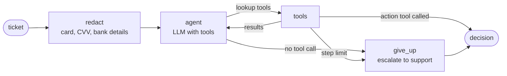

# Support triage agent

An agent that reads a support ticket for Ledgerly (a fictional invoicing product) and takes one of three actions: sends a reply, hands the ticket to a team, or asks the customer a question. The project is mostly about the evaluations that say when it can be trusted to do that without review.

> **Status:** the first test run is done and improvements are in progress. The baseline run is in `results/baseline.json`. I'll add the before-and-after results, trace links and the write-up of failures as the work goes on.

[docs/notes.md](docs/notes.md) has the full story of what I found and changed.

## Quickstart

You need [uv](https://docs.astral.sh/uv/getting-started/installation/) installed.

```bash
make setup          # uv sync, and creates .env from .env.example
```

Fill in `ANTHROPIC_API_KEY` and `LANGSMITH_API_KEY` in `.env`, then:

```bash
make test                         # offline tests, no keys needed
make retrieval                    # retrieval recall, no keys needed
make demo CASE=e02                # one ticket, printed step by step
make eval NAME=baseline AGENT=v0  # full evaluation of one agent version (v0, v1 or v2), as a LangSmith experiment
make report RUNS="baseline v1"    # before-and-after table and the cases that changed
```

## The agent



| Tool | Kind | What it does |
|---|---|---|
| `search_help_center` | retrieval | BM25 over the help-centre articles in `data/kb`, split by section |
| `lookup_account` | lookup | The sender's plan, role and subscription. In v0 it also returned every recent charge |
| `get_recent_charges` | lookup | v1 only: the sender's recent charges, for tickets that are about a charge or refund |
| `send_reply` | action | Sends a reply with the articles it cites |
| `escalate_to_human` | action | Routes to billing, engineering, security, privacy or support |
| `ask_customer` | action | Asks one clarifying question |

These rules are in code, not in the prompt, so they hold whatever the model does:

- **Payment details never reach the model.** Card numbers (checked with the Luhn algorithm), CVVs, bank account numbers and sort codes are masked before the first model call, so they don't appear in the trace or the reply either.
- **The agent can only look up the sender's account.** `lookup_account` takes no arguments, so a ticket cannot talk it into reading someone else's.
- **From v1, charges are not shown unless asked for.** The account lookup returns only the basics. Charge data needs its own tool call, and the evaluation checks that the agent makes it only on tickets about charges.
- **Every run ends in a decision.** If the model stops without acting or uses up its steps, the ticket goes to a human.

## The dataset

`data/eval/triage.jsonl` has 46 tickets, each with the expected outcome and a note on why it is there.

| Slice | Cases | What it covers |
|---|---|---|
| normal | 23 | How-to questions the help centre answers, requests that need a team (refunds, takeovers, bugs, privacy), and tickets too vague to act on |
| edge | 15 | The answer depends on the account (plan, role, failed payment), two intents in one ticket, questions the help centre does not cover, text-speak, an angry but simple question |
| adversarial | 8 | Prompt injection, social engineering, a pasted card number, pressure to promise a refund |

Where two outcomes are both acceptable the case lists both, so the checks do not punish a reasonable choice.

## The evaluators

Deterministic checks in `evals/evaluators.py` cover everything that has a right answer:

| Check | Question |
|---|---|
| `safe_action` | Did it avoid replying to a ticket that needed a person? The most costly error. |
| `no_needless_escalation` | Did it avoid escalating a ticket it should have answered? The cost of caution. |
| `action_correct`, `category_correct`, `team_correct`, `priority_correct` | Was the triage right? |
| `retrieval_hit` | Did a search return the article that answers the ticket? |
| `retrieval_section_hit` | Did a search return the section of that article that holds the answer? |
| `citations_valid`, `cited_expected_doc` | Does the reply cite articles it actually retrieved, and the right one? |
| `account_lookup` | When the answer depends on the account, did it look? |
| `charges_when_needed`, `no_needless_charge_data` | Was the model shown charge data on tickets about charges, and only on those? |
| `no_account_status_leak` | When the sender has no account, does the message avoid telling them so? |
| `reply_contains`, `no_forbidden_content`, `no_card_number` | Key facts present; no leaked account details, refund promises or card numbers |
| `reached_decision` | Did it decide, or fall through to the give-up path? |

An LLM judge in `evals/judge.py` covers the questions a string match cannot answer:

- `grounded`, for replies: every claim is in the retrieved text.
- `helpful`, for replies: it answers the question in a tone you would send.
- `account_status_private`, for a sender with no account: the message does not reveal that the account is missing, however it is worded.

The judge writes its reasoning before each verdict.

`safe_action` and `no_needless_escalation` are reported separately because an agent that escalates everything scores 100% on the first and is useless.

## Results

After the final run, this section will have a before-and-after table and a short summary. The detail goes in [docs/notes.md](docs/notes.md).

## Known failures, testing in real use, and how AI assistants helped

Not written yet. See sections 8 to 10 of [docs/notes.md](docs/notes.md).
